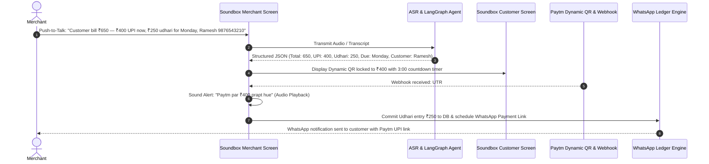
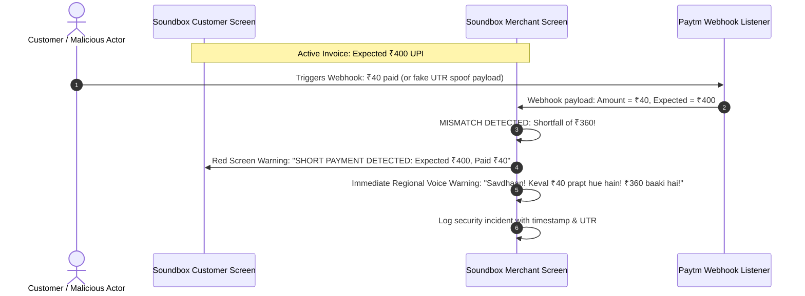
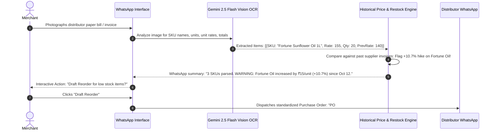

# Product Requirements Document (PRD) & Technical Design Record
## Autonomous Voice-to-QR, Partial Udhari & Restock Agent
**Paytm Build for India AI Hackathon — Chennai Edition**
**Track 1: Merchant Growth AI**
**Author:** Sayandeep Dutta (Architectural Spec & Execution Engine)

---

## 1. Executive Summary & Problem Context

### 1.1 The Counter Reality in Indian Retail
Across 12M+ Indian Kirana and retail stores, UPI powers over 83% of digital transactions. However, checkout bookkeeping remains overwhelmingly manual and disconnected:
1. **Zero Typing Time:** Shopkeepers attend to 3 to 5 customers per minute during peak evening hours (5 PM – 9 PM). Opening an app, navigating menus, and manually typing customer names, items, and credit entries is impossible without creating counter bottlenecks.
2. **Passive Soundboxes:** Standard audio Soundboxes merely announce incoming UPI credits after the customer initiates them. They have zero awareness of the bill amount, whether the payment was complete, or if credit was extended.
3. **Fragmented Records:** "Udhari" (store credit) is scrawled on paper diaries (*bahi-khata*), completely severed from digital UPI transaction logs.
4. **Three Daily Revenue Leaks:**
   - **Split Payments / Unrecorded Partial Udhari:** Merchant agrees to split a ₹650 bill into ₹400 UPI now and ₹250 udhari; the credit is forgotten in the evening rush.
   - **Short Payments & Fake Spoofs:** ₹40 paid instead of ₹400 on a static QR; merchant only hears "Paytm par 40 rupaye prapt hue" after the customer has walked away.
   - **Distributor Paper Invoices & Overbilling:** Wholesale paper bills are dumped in a drawer without tracking price creep on staple items or automated stock alerts.

### 1.2 The Solution
An active, hardware-native **Dual-Screen Paytm Soundbox Simulator + WhatsApp Execution Agent** that executes payment generation, real-time fraud/shortfall verification, automated ledger recovery, and AI-driven restocking via natural voice commands in English and regional Indian languages (Hindi, Tamil, Telugu, Hinglish).

---

## 2. Core Value Proposition & Differentiation

| Feature / Dimension | Conventional Ledger Apps (Khatabook, OkCredit) | Our Paytm Soundbox Execution Agent |
| :--- | :--- | :--- |
| **Data Entry** | Post-facto manual keyboard typing | **Zero-Typing Checkout:** Single voice command generates split QR & ledger entry |
| **QR Generation** | Static printed QR sticker (buyer types amount) | **Dynamic Amount-Locked QR:** Customer cannot edit amount on payment screen |
| **Payment Verification** | Passive sound alert after transaction | **Instant Webhook Mismatch Guard:** Flags short-payment before customer walks away |
| **Credit Collection** | Generic text SMS without embedded payment state | **Automated WhatsApp Paytm Payment Links** with instant ledger reconciliation |
| **Inventory / Wholesale** | Disconnected or manual inventory entry | **WhatsApp Snap-to-Restock Agent:** Vision OCR on distributor bills, price-hike flags, 1-click reorder |
| **Form Factor** | Separate smartphone app (app fatigue) | **Dual-Screen Counter Hardware + WhatsApp Native** |

---

## 3. The Three Core Demonstrable Flows

### Flow 1: Voice-to-Dynamic-QR & Split Udhari


### Flow 2: Real-Time Mismatch & Spoof Guard


### Flow 3: WhatsApp Snap-to-Restock Agent


---

## 4. System Architecture & Tech Stack

```
+---------------------------------------------------------------------------------+
|                                 USER INTERFACES                                 |
|                                                                                 |
|  +-------------------------------------+   +---------------------------------+  |
|  |     PAYTM DUAL-SCREEN SOUNDBOX      |   |       WHATSAPP SIMULATOR        |  |
|  |                                     |   |                                 |  |
|  |  [Merchant Counter Screen]          |   |  - Customer Udhari Ledger Chat  |  |
|  |  * Push-to-Talk Mic (Web Audio)     |   |  - Embedded Paytm Payment Links |  |
|  |  * Live Intent / Split Breakdown    |   |  - Distributor Bill Snap / OCR  |  |
|  |  * Mismatch Siren / Spoof Guard     |   |  - Restock PO Draft Generator   |  |
|  |  * Active Counter Invoice Queue     |   |                                 |  |
|  |                                     |   |                                 |  |
|  |  [Customer Facing Screen]           |   |                                 |  |
|  |  * Amount-Locked Dynamic QR         |   |                                 |  |
|  |  * Expiry Countdown (180s)          |   |                                 |  |
|  |  * Success & Green Tick Banner      |   |                                 |  |
|  +-------------------------------------+   +---------------------------------+  |
|                     ^                                       ^                   |
+---------------------|---------------------------------------|-------------------+
                      v                                       v
+---------------------------------------------------------------------------------+
|                       FASTAPI APPLICATION SERVER (BACKEND)                      |
|                                                                                 |
|  - REST Endpoints (/api/voice, /api/qr, /api/webhook, /api/udhari, /api/restock)|
|  - Real-Time Push Events: Server-Sent Events (SSE) or WebSocket                 |
|  - Audio Synthesizer: Soundbox voice announcements in English & Hindi           |
|                                                                                 |
|  +---------------------------+   +-------------------------------------------+  |
|  |   AI / AGENTIC MODULES    |   |           DATABASE / DATA LAYER           |  |
|  |                           |   |                                           |  |
|  | * Sarvam / Whisper ASR    |   | * SQLite / PostgreSQL Database            |  |
|  | * Groq Llama-3.3-70B +     |   |   - Merchants & Settings                  |  |
|  |   LangGraph Intent Parser |   |   - Active & Archived Transactions        |  |
|  | * Gemini 2.5 Flash Vision |   |   - Udhari Ledger Records                 |  |
|  |   Invoice OCR & Auditor   |   |   - Historical SKU & Supplier Price Logs  |  |
|  +---------------------------+   +-------------------------------------------+  |
+---------------------------------------------------------------------------------+
```

### Detailed Tech Stack Specifications
1. **Speech & Regional ASR:**
   - Primary: Sarvam AI Speech-to-Text API (Optimized for Indian regional languages and Hinglish).
   - Fallback / Offline: Whisper API / Local Browser SpeechRecognition API with Indian English / Hindi dialect support.
2. **Agentic Tool Calling & Intent Decomposition:**
   - Groq (Llama-3.3-70B-versatile) / LangGraph workflow.
   - Ultra low latency (< 600ms) outputting strictly validated JSON schema:
     - `total_amount`: float
     - `upi_amount`: float
     - `udhari_amount`: float
     - `due_date`: ISO string or formatted date
     - `customer_name`: string
     - `customer_phone`: string
     - `items`: optional array of item descriptions
3. **Invoice Vision OCR & Margin Auditor:**
   - Gemini 2.5 Flash Vision API.
   - Extracts tabular line-items from crumpled, photographed Indian distributor invoices (Bill No, Date, Vendor Name, Item Description, Quantity, Unit Rate, GST%, Total).
4. **Payment & Messaging Layer:**
   - Paytm Dynamic QR Payload Generator (`upi://pay?pa=paytmmerchant@paytm&pn=KiranaStore&am=400.00&tr=TXN123456...`).
   - Mock Paytm Webhook Receiver with real-time UTR reconciliation.
   - WhatsApp Cloud API simulation (delivering WhatsApp interactive messages with "Pay via Paytm" button).
5. **Backend & Frontend:**
   - Backend: FastAPI (Python 3.12+), Pydantic v2, SQLite / asyncpg.
   - Frontend: Next.js / React 19, Tailwind CSS, Lucide icons, styled strictly using Paytm Clean Commerce guidelines (`#002970` Paytm Deep Blue, `#00B9F2` Cyan, `#12B76A` Success Green, `#D92D20` Alert Red).

---

## 5. Data Models & Database Schema

### 5.1 Tables
1. **`merchants`**
   - `id`: UUID (Primary Key)
   - `store_name`: string (e.g. "Sri Lakshmi Stores")
   - `vpa`: string (e.g. "srilakshmi@paytm")
   - `phone`: string
   - `default_language`: enum ("en", "hi", "ta", "te")

2. **`transactions`**
   - `id`: UUID (Primary Key)
   - `invoice_id`: string (e.g. "INV-2026-001")
   - `total_bill`: decimal
   - `upi_due`: decimal
   - `upi_received`: decimal (default 0.0)
   - `cash_received`: decimal (default 0.0)
   - `status`: enum (`PENDING_PAYMENT`, `COMPLETED`, `SHORT_PAYMENT`, `EXPIRED`)
   - `utr`: string (nullable)
   - `qr_data`: string
   - `created_at`: timestamp
   - `completed_at`: timestamp (nullable)

3. **`udhari_ledger`**
   - `id`: UUID (Primary Key)
   - `transaction_id`: UUID (Foreign Key)
   - `customer_name`: string
   - `customer_phone`: string
   - `amount_due`: decimal
   - `due_date`: date
   - `status`: enum (`UNPAID`, `REMINDER_SENT`, `SETTLED`)
   - `paytm_payment_link`: string
   - `payment_link_id`: string
   - `settled_at`: timestamp (nullable)

4. **`sku_price_history`**
   - `id`: UUID (Primary Key)
   - `sku_name`: string (e.g. "Fortune Sunlite Oil 1L")
   - `category`: string
   - `supplier_name`: string
   - `unit_rate`: decimal
   - `invoice_date`: date
   - `invoice_image_url`: string

5. **`restock_orders`**
   - `id`: UUID (Primary Key)
   - `supplier_name`: string
   - `supplier_phone`: string
   - `items`: JSON array `[{"sku": string, "quantity": int, "expected_rate": decimal}]`
   - `status`: enum (`DRAFT`, `DISPATCHED_WHATSAPP`, `CONFIRMED`)
   - `created_at`: timestamp

---

## 6. Detailed API Endpoints

### 6.1 Voice & Intent
- `POST /api/voice/parse`:
  - Body: `{ audio_base64: string, language: string }` OR `{ transcript_text: string }`
  - Returns: Extracted transaction intent with split breakdown:
    ```json
    {
      "success": true,
      "transcript": "Customer bill 650, 400 UPI now, 250 udhari for Monday, Ramesh 9876543210",
      "data": {
        "total_bill": 650.0,
        "upi_amount": 400.0,
        "udhari_amount": 250.0,
        "due_date": "2026-11-17",
        "customer_name": "Ramesh",
        "customer_phone": "9876543210"
      }
    }
    ```

### 6.2 Counter & QR Generation
- `POST /api/counter/create-invoice`:
  - Creates transaction, generates dynamic amount-locked QR, initializes Udhari draft.
  - Returns: `{ invoice_id: "INV-1092", qr_code_url: "...", amount: 400.0, expires_in: 180 }`
- `GET /api/counter/active`:
  - Returns current active counter transaction state for dual-screen sync.

### 6.3 Webhook & Spoof Guard Simulation
- `POST /api/paytm/webhook`:
  - Simulates incoming Paytm UPI payment notification:
    ```json
    {
      "merchant_vpa": "srilakshmi@paytm",
      "utr": "PAYTM982736154",
      "amount": 400.00,
      "status": "SUCCESS",
      "invoice_id": "INV-1092"
    }
    ```
  - Logic:
    - If `amount == active_invoice.upi_due`: Broadcast `PAYMENT_SUCCESS`, announce audio, trigger WhatsApp Udhari link.
    - If `amount < active_invoice.upi_due`: Broadcast `SHORTFALL_ALERT`, calculate deficit, trigger voice alarm, flash red screen.

### 6.4 WhatsApp & Udhari Management
- `GET /api/udhari/list`: Fetch all pending and settled credits.
- `POST /api/udhari/send-reminder`: Dispatches WhatsApp payment reminder with instant Paytm link.
- `POST /api/udhari/reconcile`: Webhook callback when customer pays the WhatsApp link.

### 6.5 Invoice OCR & Restock
- `POST /api/restock/analyze-invoice`:
  - Multipart upload of bill image.
  - Analyzes items, queries historical unit rates from DB, flags price hikes > 5%, drafts low stock purchase order.
- `POST /api/restock/send-po`: Dispatches reorder message to supplier WhatsApp.

---

## 7. UI/UX Design: Dual-Screen Paytm Soundbox Simulator

The user interface will be built as an ultra-crisp, interactive web application featuring 3 synchronized panels:
1. **Left Panel: Merchant Counter Screen (Paytm Smart Soundbox Pro)**
   - Push-to-Talk microphone button with live visualizer waveform.
   - Quick preset voice prompts (e.g., "₹650 total — ₹400 UPI now, ₹250 udhari for Monday", "₹200 Full UPI", "₹1200 split with ₹500 cash").
   - Live Intent Parser card displaying extracted entities in real time.
   - Spoof Guard Alert Banner (changes from Paytm Blue to Emergency Red on mismatch).
   - Audio Soundbox simulator with playable voice announcements in Hindi and English.
2. **Center Panel: Customer-Facing Soundbox Display**
   - High-contrast, sunlight-readable design.
   - Prominent Dynamic UPI QR code locked to exact UPI due amount.
   - Dynamic countdown timer (180s) and status badge ("Scan to Pay via any UPI App").
   - Instant full-screen success checkmark animation upon webhook verification.
   - Instant warning screen on short-payment: "₹40 Paid, Balance ₹360 Due".
3. **Right Panel: WhatsApp Ledger & Restock Companion**
   - Realistic WhatsApp Kirana chat interface.
   - Customer thread: Shows scheduled and dispatched Paytm Payment Links with 1-click customer payment simulator.
   - Distributor thread: Snap-to-Restock demo tab allowing upload of distributor invoices, showing Gemini Vision OCR results, rate comparison flags, and automated PO generation.

---

## 8. Measurable Business Outcomes & Commercial Viability
- **₹49/month Value-Added Software Subscription:** Seamlessly bundled with existing Paytm Soundbox rentals (currently ~₹125/month).
- **Off-Counter Payment Link Volume:** Digitalizes informal cash credit into Paytm Payment Link transactions.
- **Verified Cash-Flow Underwriting:** Captures real-time sales and wholesale expenditure data, providing Paytm with pristine data to underwrite Merchant Cash Advance loans.
- **Merchant Retention:** Eliminates paper notebooks, locking the merchant securely into the Paytm ecosystem.
